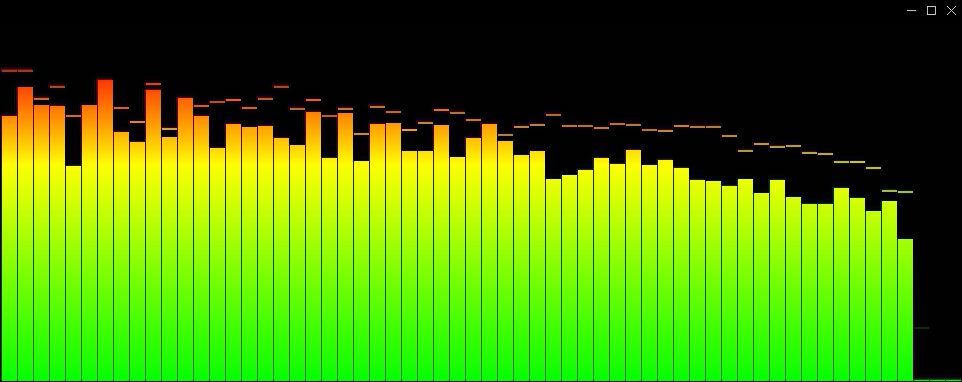
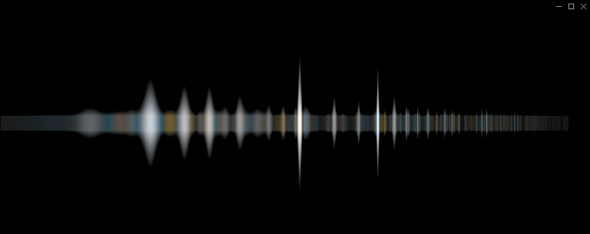

## MPV-vis

Visualizers for mpv, forked from https://github.com/mfcc64/mpv-scripts

v 2026-11-10-11-08-49

- modified: qtbar, removed text in the middle
- added: spectrum visualiser inspired by vlc spectrum. spectrum is default. to change default change `name` variable in `visualizer.lua`
- add osd with vis name

## lua files:

- visualizer.lua - various audio visualization.
- firequalizer.lua - linear phase 15-bands equalizer (this is not graphic, it is automatically used)

## installation:

- to download zip file, click on it on the top of the screen, then click on the arrow pointing down (on the right), to download zip file to pc
- in mpv folder, create folder `scripts`
- copy lua files to `scripts` folder
- You can alternatively copy lua files to `%appdata%/mpv/scripts`, or `.config/mpv/scripts`

## key bindings:

- use c key to flip through vis models
- use standard f key to go to fullscreen in mpv.

## modifying visualizer.lua

- you can modify spectrum values. lower quality if spectrum takes too much cpu, currently it is set to `low`. (It uses a bit more cpu than qt vis)
